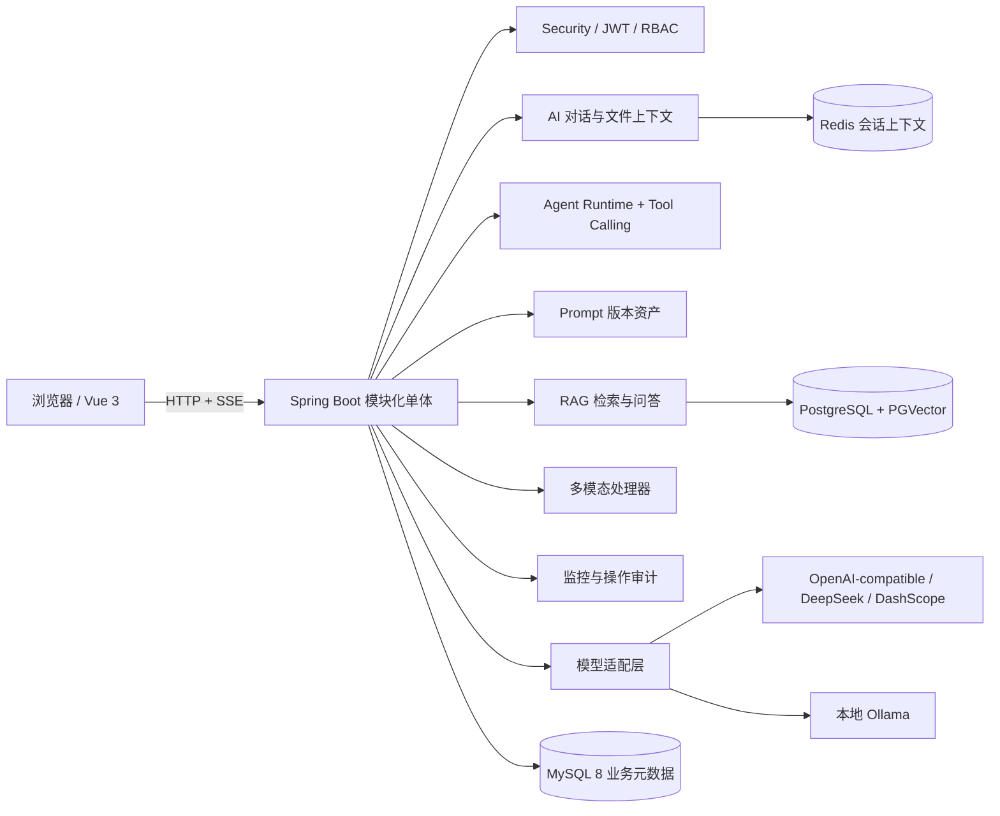
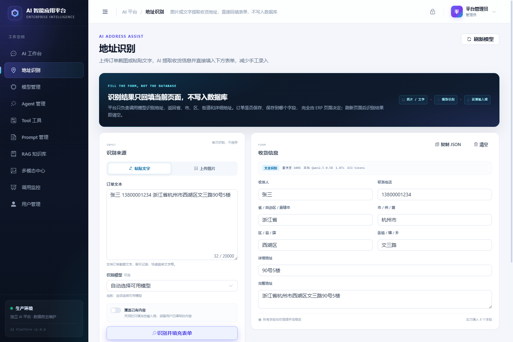
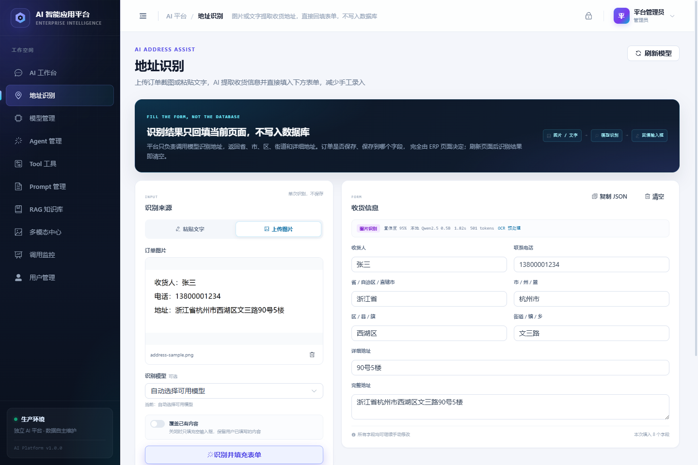
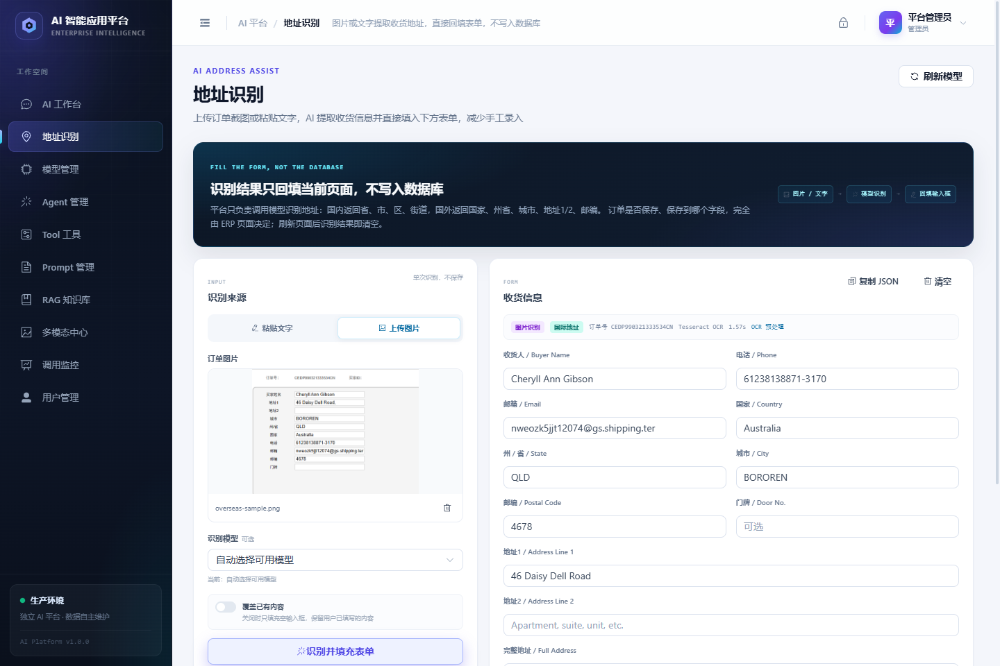
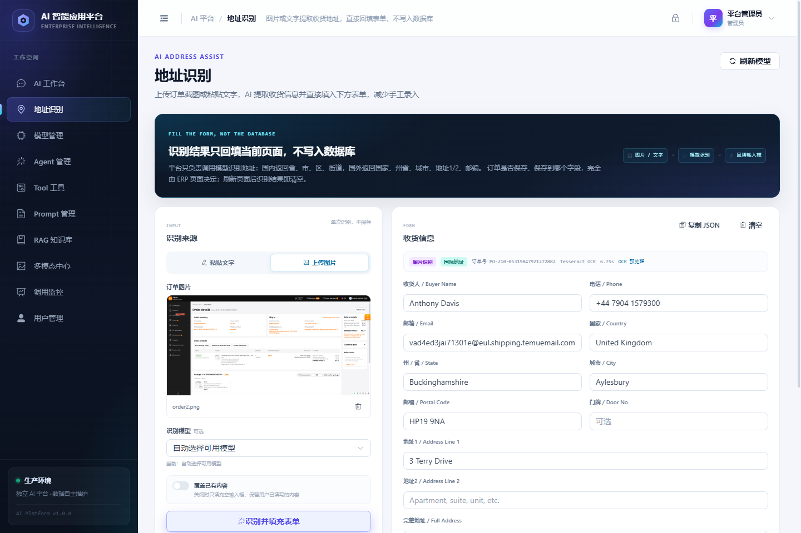
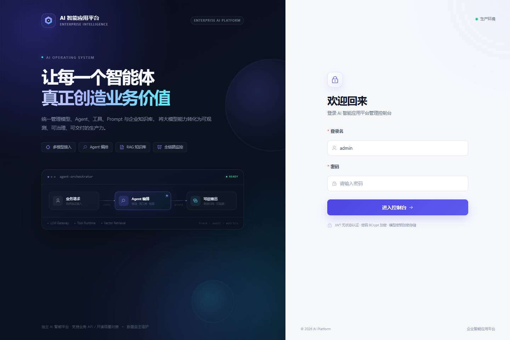

# AI 智能应用平台

独立的企业级 AI 智能应用平台。统一管理真实大模型、Agent、Tool、Prompt、RAG 知识库、多模态任务、地址识别与调用监控。

> **项目边界**：平台保持独立，不把订单业务写入平台。当前运行库为本地 `ai_platform`；ERP 等业务系统通过 HTTP API 对接，默认不直连业务库、不授予写权限。地址识别结果只回填调用方页面，不落库、不保存图片；数据库中的演示业务数据保留用于验收展示，正式上线前必须替换为真实接口。

当前阶段：**P0 → P6 全部完成并在本机实际编译、构建、测试与浏览器操作验证。**

---

## 一、交付进度

| 阶段 | 范围 | 状态 |
|---|---|---|
| P0 | Maven 多模块骨架、登录/JWT/RBAC、强制改密、管理台布局、用户管理、Flyway、Docker/Nginx | ✅ 已完成并验证 |
| P1 | 模型管理、API Key 加密、真实连通测试、AI 对话、SSE、Token 统计、文件上下文 | ✅ 已完成并验证 |
| P2 | Agent 调试与执行追踪、6 个真实 Java Tool、Prompt 变量/版本/发布/回滚/测试 | ✅ 已完成并验证 |
| P3 | 文档解析、切片、真实 Embedding、PostgreSQL + PGVector 检索、RAG 问答与来源 | ✅ 已完成并验证 |
| P4 | 图片理解/OCR、PDF/Word/Excel 文档处理、语音 ASR 适配、多模态任务中心 | ✅ 已完成并验证 |
| P5 | 调用监控、Token/耗时/费用统计、Agent/Tool/RAG/多模态执行域、操作审计 | ✅ 已完成并验证 |
| P6 | 图片/文字地址识别、省市区街道拆分、表单回填、ERP 开放 API、API Key 认证 | ✅ 已完成并验证 |

每个阶段都执行：后端编译与测试 → 前端类型检查与生产构建 → 浏览器实际操作 → 更新 README/API/验收记录。

**关键真实性约束：**

- AI 对话、Agent、Prompt 测试、RAG 问答、图片理解均调用真实模型接口。
- Tool 调用会实际执行 Spring Bean 方法；计算器与订单/库存/客户查询结果来自真实 Java 逻辑与本地演示库。
- RAG 真实调用 Embedding 模型，将向量写入 PostgreSQL + PGVector，再按余弦距离检索。
- 未配置 Key 的云模型明确显示“未连接”；扫描版 PDF、无 ASR 模型等不支持场景明确失败，不伪造结果。
- 监控数据严格区分 `REAL` 与 `SIMULATED`；演示数据在页面、API 和数据库中均有标记。

---

## 二、技术栈与版本

| 分类 | 技术 | 本机验证版本 |
|---|---|---|
| 运行时 | JDK | 21.0.13 |
| 构建 | Maven | 3.9.2 |
| 后端 | Spring Boot | 3.4.5 |
| AI 框架 | LangChain4j | 1.0.1 |
| ORM | MyBatis-Plus | 3.5.12 |
| 认证 | Spring Security + JJWT | 6.4.x + 0.12.6 |
| 业务库 | MySQL | 8.0.46 |
| 向量库 | PostgreSQL + PGVector | 18.6 / 0.8.7（本机）；Compose 使用 16 |
| 缓存 | Redis | 5.0.14.1（本机）；Compose 使用 7.4 |
| 迁移 | Flyway | Spring Boot 统一管理 |
| 文档解析 | Apache POI / PDFBox | 5.4.1 / 3.0.4 |
| 本地 OCR | Tesseract + chi_sim | 5.4.0 |
| 前端 | Vue 3 + TypeScript + Vite | 3.5.44 / 5.7.3 / 6.4.5 |
| UI | Element Plus + Pinia + Vue Router | 2.14.7 / 3.0.4 / 4.6.4 |
| 图表 | ECharts | 5.6.0 |
| 本地模型 | Ollama | 0.40.13 |

不使用 Spring Cloud、Nacos、Gateway、Kafka、RocketMQ、Kubernetes。

---

## 三、总体架构



### 工程结构

```text
ai-platform/
├── ai-dependencies/            统一父 POM / BOM
├── ai-common/                  响应、异常、分页、安全上下文、Token 估算、RAG SPI
├── ai-platform-server/         启动入口、认证、用户、Flyway、Dockerfile
├── ai-module-model/            模型配置、API Key 加密、Chat/Vision/Embedding/ASR 适配
├── ai-module-chat/             会话、消息、SSE 流式对话
├── ai-module-agent/            Agent 配置/版本、AI Services 执行、步骤与限额
├── ai-module-tool/             工具注册、Schema 校验、真实 Java Bean 执行
├── ai-module-prompt/           Prompt 变量、版本、测试、发布、回滚
├── ai-module-rag/              文档解析、切片、Embedding、PGVector、RAG 问答
├── ai-module-multimodal/       文件资产、图片/文档/音频任务
├── ai-module-integration/      地址识别、表单回填、ERP 开放 API
├── ai-module-monitor/          调用统计与日志查询
├── ai-module-audit/            管理端写操作审计
├── ai-web/                     Vue 3 管理台
├── deploy/                     Nginx、PostgreSQL 初始化
├── docs/                       架构、API、验收记录、SQL
├── docker-compose.yml
├── .env.example
└── README.md
```

---

## 四、数据库设计

### MySQL（业务元数据）

| 域 | 主要表 | 说明 |
|---|---|---|
| 认证 | `ai_user`、`ai_login_log`、`ai_operation_audit` | 用户、登录、管理操作审计 |
| 模型 | `ai_model_provider`、`ai_model_config`、`ai_model_call_log` | 供应商、模型、真实/模拟调用 |
| 对话 | `ai_conversation`、`ai_message`、`ai_file_asset` | 会话、消息、附件 |
| Agent | `ai_agent`、`ai_agent_version`、`ai_agent_execution`、`ai_agent_step` | 配置版本、执行、步骤 |
| Tool | `ai_tool`、`ai_tool_execution_log`、`ai_demo_order/inventory/customer` | 工具元数据与本地演示业务数据 |
| Prompt | `ai_prompt`、`ai_prompt_version` | 变量、不可变版本 |
| RAG | `ai_knowledge_base`、`ai_knowledge_document`、`ai_knowledge_chunk`、`ai_rag_query_log` | 知识库、文档、切片、查询 |
| 多模态 | `ai_multimodal_task` | 图片/文档/音频任务与结果 |

### PostgreSQL + PGVector

```sql
CREATE TABLE ai_chunk_embedding (
  chunk_id BIGINT PRIMARY KEY,
  knowledge_base_id BIGINT NOT NULL,
  document_id BIGINT NOT NULL,
  embedding_model_id BIGINT NOT NULL,
  embedding_dim INT NOT NULL,
  embedding vector NOT NULL,
  created_at TIMESTAMPTZ NOT NULL DEFAULT now()
);
```

当前环境允许不同维度的 Embedding 模型并存，因此使用不固定维度的 `vector` 列，并在检索时强制过滤模型与维度。数据量较大时应按维度拆表并建立 HNSW/IVFFlat 索引。

### Redis

- `ai:chat:memory:{conversationId}`：LangChain4j 短期会话记忆。
- `ai:chat:task:{taskId}`：流式任务状态。

### 页面规划

| 页面 | 核心能力 |
|---|---|
| AI 工作台 | 多模型对话、SSE、多轮上下文、Markdown、代码块、附件 |
| 模型管理 | 供应商、密钥掩码、能力标签、连接测试、单价 |
| Agent 管理 | 模型与工具绑定、System Prompt、限额、调试、步骤、执行历史、版本 |
| Tool 工具 | 工具注册、参数 Schema、真实执行、执行记录 |
| Prompt 管理 | 变量识别、版本、模型测试、发布、回滚 |
| RAG 知识库 | 知识库、上传/示例文档、切片预览、向量化、问答与来源 |
| 多模态中心 | 图片理解/OCR、PDF/Word/Excel、语音转写、任务历史 |
| 地址识别 | 图片/文字提取国内省市区或国外国家/州省/城市/邮编，直接回填表单，不落库 |
| 调用监控 | KPI、趋势、调用类型、模型分布、日志筛选、费用未知标识 |
| 用户管理 | 账号、角色、启停、重置密码 |

---

## 五、管理账号

系统首次启动时由 `DemoAccountInitializer` 创建：

| 角色 | 登录名 | 初始密码 | 默认状态 | 权限 |
|---|---|---|---|---|
| 管理员 | `admin` | `Admin@123456` | 启用 | 全部管理功能 |
| 普通用户 | `demo` | `Demo@123456` | **禁用** | AI 工作台、多模态等业务功能 |

页面默认不再展示 demo 快捷登录卡片；`demo` 账号保留但 `enabled=0`。需要验收普通用户界面时，显式设置：

```bash
AI_PLATFORM_DEMO_ENABLED=true
```

再重启后端即可创建/启用 demo 账号。两个账号的 `must_change_password` 初始均为 `true`；登录后强制改密，改密后 `token_version` 递增，旧 JWT 立即失效。

---

## 六、Docker Compose

```bash
cp .env.example .env
# 修改 JWT_SECRET / MASTER_KEY / 数据库密码 / 初始密码
docker compose up -d --build
docker compose ps
```

| 入口 | 地址 |
|---|---|
| 管理台 | http://localhost |
| 健康检查 | http://localhost:8080/api/health |
| Swagger UI | http://localhost:8080/swagger-ui.html |
| OpenAPI JSON | http://localhost:8080/v3/api-docs |

> 当前验收机器没有 Docker daemon，因此镜像未在本机实际构建；Compose/Nginx/PG 初始化配置已完成 YAML 与路径校验。具备 Docker 的环境可直接构建。

---

## 七、本地开发

### 前置要求

- JDK 21，Maven 3.9+
- Node.js 20.19+ / pnpm 10+
- MySQL 8
- Redis 7+（本机兼容 Redis 5）
- PostgreSQL 16+，安装 PGVector 扩展

### 1. MySQL

```bash
# 运行库（应用启动只使用 ai_platform）
mysql -uroot -p < docs/sql/init-local.sql

# 可选：仅在需要运行 Maven 集成测试时执行
mysql -uroot -p < docs/sql/init-test.sql
```

运行库：`ai_platform`；测试库 `ai_platform_test` 仅供 Maven 集成测试使用，不参与应用启动。用户：`ai_platform / AiPlatform@2026`。

### 2. Redis

确保 `127.0.0.1:6379` 可用；如设置密码，通过 `REDIS_PASSWORD` 注入。

### 3. PostgreSQL + PGVector

```sql
CREATE ROLE ai_platform LOGIN PASSWORD 'AiPlatform@2026';
CREATE DATABASE ai_platform_vector OWNER ai_platform;
\c ai_platform_vector
CREATE EXTENSION IF NOT EXISTS vector;
```

应用默认连接：

```text
jdbc:postgresql://127.0.0.1:5432/ai_platform_vector
ai_platform / AiPlatform@2026
```

可用 `PGVECTOR_URL`、`PGVECTOR_USERNAME`、`PGVECTOR_PASSWORD` 覆盖。应用启动时自动创建 `ai_chunk_embedding` 表；PGVector 不可用时应用仍可启动，但 RAG 接口会返回明确错误。

### 4. 后端

```powershell
$env:JAVA_HOME="D:\path\to\jdk-21"
# 可选：启用面向 ERP 的开放接口
$env:AI_PLATFORM_OPEN_API_ENABLED="true"
$env:AI_PLATFORM_OPEN_API_KEY="replace-with-a-random-key"
mvn -B -ntp test
mvn -B -ntp -DskipTests package
java -jar ai-platform-server/target/ai-platform-server.jar
```

Flyway 自动应用 `ai-platform-server/src/main/resources/db/migration/` 下的 V1–V7。

### 5. 可选：本地 OCR 兜底

图片地址识别优先走视觉模型；没有可用视觉模型时，可用本地 Tesseract OCR：

```powershell
winget install UB-Mannheim.TesseractOCR
# 下载 chi_sim.traineddata 到 data/tessdata/
# https://github.com/tesseract-ocr/tessdata_fast/raw/main/chi_sim.traineddata
```

默认配置 `ai-platform.ocr.tessdata-dir=./data/tessdata`，Windows 会自动探测
`C:\Program Files\Tesseract-OCR\tesseract.exe`。未安装时自动跳过，不影响文本识别。

### 6. 前端

```bash
cd ai-web
pnpm install
pnpm dev
```

访问 http://127.0.0.1:5173，Vite 将 `/api` 代理到 8080。

---

## 八、真实模型配置

### 种子模型

迁移只初始化 **3 个云模型**，均未配置 API Key：

- DeepSeek Chat（TEXT / TOOL_CALLING）
- 通义 Embedding v3（EMBEDDING，1024 维）
- 通义千问 VL Max（VISION）

在「模型管理」中填入真实 Key、测试连通后即可用于对话、Agent 与多模态。单价未配置时，费用始终显示“未知”。

### 本机验收用本地 Ollama（可选）

本机为完成真实调用验收，额外接入了 3 个 Ollama 模型（不属于迁移种子）：

| 显示名 | 模型标识 | 类型 | 用途 |
|---|---|---|---|
| 本地 Qwen2.5 0.5B | `qwen2.5:0.5b` | TEXT + TOOL_CALLING | 对话、Agent、RAG 回答、Prompt 测试 |
| 本地 Nomic Embedding | `nomic-embed-text:latest` | EMBEDDING / 768 | 知识库向量化与检索 |
| 本地 Moondream 视觉模型 | `moondream` | VISION | 图片理解 / OCR |

启动：

```bash
ollama serve
ollama pull qwen2.5:0.5b
ollama pull nomic-embed-text
ollama pull moondream
```

然后在「模型管理」新增，供应商选择 `Ollama 本地模型`，API Key 留空。RAG 知识库需在「编辑」中把 Embedding 模型切换为本地 Nomic（已有向量时先清空文档）。Seed 的 2 个知识库在全新数据库中为空，可在页面上点击「导入示例文档」走真实向量化流程。

---

## 九、验收步骤

详细证据见 [验收记录](docs/acceptance.md)。

### P0 认证与管理台

1. 打开 `/login`，使用 `admin / Admin@123456` 登录，应强制跳转改密。
2. 错误密码只提示“用户名或密码错误”，不泄漏账号是否存在。
3. 未登录访问 `/users` 被路由守卫拦截；普通用户访问管理接口返回 403。
4. 完成改密后旧 Token 失效；用户管理中新增/停用用户真实生效。

### P1 模型与真实对话

1. 模型管理显示 3 个种子模型，未配置 Key 显示“未连接”。
2. 配置本地 Ollama 或云 Key，点击「测试」产生真实请求。
3. AI 工作台选择可用模型，回答逐字流式出现；Markdown、代码块、Token、耗时正常。
4. 上传 TXT/Markdown，消息附件保留并被模型引用。
5. API Key 接口只返回掩码；数据库密文以 `v1:` 开头。

### P2 Agent / Tool / Prompt

1. 工具页调试「计算器」，输入 `(1280*3+960)/4 + sqrt(16)`，返回 `1204`；执行记录出现。
2. 调试「查询订单」，输入 `SO20260001`，返回本地模拟订单状态，明确标记 `SIMULATED_LOCAL_DB`。
3. Agent 页调试「数据分析助手」，输入订单查询问题；执行步骤应包含模型请求、工具调用、工具结果、最终回答，并记录 Token 与工具日志。
4. 创建/编辑 Agent 生成新版本；执行历史可查看步骤。
5. Prompt 页保存生成新版本、发布、回滚；测试走真实模型并返回渲染后 Prompt。
6. 将 Agent 最大工具次数设为 1、构造重复工具请求，执行状态应变为 `LIMIT_EXCEEDED`（自动化测试覆盖）。

### P3 RAG 知识库

1. 在「模型管理」准备可用 Embedding 模型；进入「RAG 知识库」。
2. 编辑知识库，绑定 Embedding 模型，保存。
3. 点击「导入示例文档」或上传 TXT/Markdown/PDF/DOCX/XLSX。
4. 文档状态变为「就绪」，显示字符数与切片数；点击「切片」可查看原文片段。
5. 进入「知识问答」，选择知识库与文本模型，提问应返回回答、Token、耗时和来源片段（文档名、片段号、相似度、原文）。
6. 在 PostgreSQL 执行 `SELECT count(*) FROM ai_chunk_embedding;`，向量数量与页面切片数一致。
7. 在 Tool 页调试「文档检索」，返回 `dataSource=RAG_VECTOR` 与来源。

### P4 多模态

1. 上传 PNG/JPG，选择视觉模型，执行图片理解/OCR，结果应来自真实 VLM 接口。
2. 上传 PDF/DOCX/XLSX，选择「仅解析文本」可得到真实解析结果；选择文本模型可生成摘要/抽取。
3. 上传 MP3/WAV/M4A，选择 ASR 模型执行转写；无 ASR 模型时应明确失败，不伪造文本。
4. 任务历史保存每个任务的模型、Token、耗时、状态与错误原因。
5. 本机已用 Moondream 完成真实图片理解；ASR 适配器由本地 OpenAI-compatible 协议桩完成端到端集成测试，真实生产需配置 ASR 供应商。

### P5 调用监控

1. 打开「调用监控」，查看 KPIs、趋势、调用类型、模型分布与执行域统计。
2. 页面顶部明确展示 SIMULATED 数据条数与真实调用条数。
3. 费用列在未配置单价时显示“未知”，不显示猜测金额。
4. 按类型、数据源、结果、关键字筛选调用日志；分页正常。
5. 管理端新增/修改操作写入 `ai_operation_audit`。

### P6 地址识别与表单回填

1. 打开「地址识别」，粘贴订单文本，点击「识别并填充表单」。
2. 收货人、电话、省、市、区、街道、详细地址、完整地址应直接写入右侧输入框。
3. 关闭「覆盖已有内容」时，仅填充空字段，保留用户手工输入。
4. 切换到「上传图片」，上传订单截图/快递面单。图片先走视觉模型；视觉模型不能直接输出 JSON 时，自动用本地 Tesseract `chi_sim+eng` OCR 识别文字，再交给文本模型抽取，返回 `ocrUsed=true`。
5. 国外地址会识别为 `addressType=INTERNATIONAL`，页面自动切换为「国家 / 州省 / 城市 / 邮编 / 地址1 / 地址2」表单，不再强行套用中国省市区。
6. 支持整页订单详情截图：自动识别 `Order details`、`Recipient name`、`Phone number`、`Shipping address`、`Virtual email` 等区域；复杂版式会结合标签解析、地址块解析和宽松正则兜底。
7. 刷新页面或点击「清空」后，识别结果消失；平台不保存地址原文、图片或识别结果。
8. ERP 服务端调用 `POST /api/open/v1/address/extract`，请求头携带 `X-API-Key`，返回同一结构 JSON；无 Key/错误 Key 返回 401。
9. 自动化测试断言：调用前后 `ai_model_call_log` 数量不变，地址识别不新增任何数据库记录。



图片 OCR 兜底实际效果：



国外地址自动切换为国际表单：



整页订单详情截图：



整页订单详情截图也能识别 `Order details / Recipient name / Phone number / Shipping address / Virtual email`：


---

## 十、自动化验证

```bash
# 后端全量
mvn -B -ntp test

# 前端
cd ai-web
pnpm test
pnpm build
```

本机结果：

- 后端 **53** 个测试通过：认证 4、SSE 1、P2 管理/Agent/Prompt/Monitor 5、P4 ASR 1、地址识别集成 1、地址解析 22、模型加密 3、Tool 参数/计算器 8、切片 3、文档解析 5。
- 前端 **4** 个单元测试通过。
- `vue-tsc` 类型检查与 Vite 生产构建通过。
- 验证环境：MySQL 8.0.46、Redis 5、PostgreSQL 18.6 + PGVector 0.8.7、Ollama 0.40.13。

---

## 十一、安全设计

- JWT 无状态认证；首登强制改密，改密后 `token_version` 递增。
- 模型 API Key 使用 AES-256-GCM 加密（随机 IV），接口仅返回掩码；日志脱敏。
- 管理端写操作审计：`ai_operation_audit`，不记录请求体。
- 上传文件扩展名白名单 + 魔数校验 + UTF-8 校验 + 随机存储名 + 用户隔离。
- Tool 参数 JSON Schema 校验，真实 Java Bean 调用，不执行任意代码；工具次数/执行时间/成本限额。
- RAG 只返回真实检索来源；无上下文不编造；扫描版 PDF 明确提示 OCR。
- 多模态按文件类型路由；缺少 VISION/ASR 能力时明确失败。
- 地址识别只返回结果，不写订单/地址表、不保存图片；图片识别优先视觉模型，失败时用本地 Tesseract OCR 兜底，不伪造结果。
- 开放接口使用 `X-API-Key` 常量时间比较，默认关闭。
- 费用仅在配置单价且 Token 完整时计算；否则“未知”。

---

## 十二、常用接口

完整接口见 [API 文档](docs/api.md)，交互式调试：http://localhost:8080/swagger-ui.html。

| 方法 | 路径 | 权限 | 说明 |
|---|---|---|---|
| POST | `/api/auth/login` | 公开 | 登录 |
| POST | `/api/chat/stream` | 登录 | SSE 流式对话 |
| GET/POST | `/api/admin/models/**` | ADMIN | 模型管理与测试 |
| GET/POST | `/api/admin/agents/**` | ADMIN | Agent 管理、调试、执行历史 |
| POST | `/api/admin/agents/{id}/debug` | ADMIN | 真实 Agent + Tool 执行 |
| GET/POST | `/api/admin/tools/**` | ADMIN | 工具管理、调试、执行记录 |
| GET/POST | `/api/admin/prompts/**` | ADMIN | Prompt 版本、测试、发布、回滚 |
| GET/POST | `/api/admin/rag/**` | ADMIN | 知识库、文档、向量化、切片 |
| POST | `/api/rag/query` | 登录 | 真实向量检索 + 模型回答 + 来源 |
| POST | `/api/multimodal/tasks` | 登录 | 图片/文档/音频处理 |
| POST | `/api/address/extract` | 登录 | 文本地址识别（不落库） |
| POST | `/api/address/extract/image` | 登录 | 图片地址识别（不落库） |
| POST | `/api/open/v1/address/extract` | API Key | ERP 服务端文本地址识别 |
| POST | `/api/open/v1/address/extract/image` | API Key | ERP 服务端图片地址识别 |
| GET | `/api/admin/monitor/overview` | ADMIN | 监控总览 |
| GET | `/api/admin/monitor/calls` | ADMIN | 调用日志分页 |

---

## 十三、界面

生产模式登录页（不再展示 demo 快捷登录卡片和 DEMO 标识）：



历史验收截图位于 `docs/screenshots/`，其中包含早期开发阶段的截图，页面文案可能早于当前生产模式版本。

---

## 十四、已知限制

- 当前机器无 Docker daemon，镜像未实际构建；配置已在具备 Docker 的环境待验证。
- ASR 使用 OpenAI-compatible `/audio/transcriptions` 适配器；本机未配置真实 ASR 供应商，使用协议桩完成集成测试。生产需配置支持 ASR 的端点。
- 演示知识库的向量维度采用不固定列以兼容多模型；生产大数据量应改为固定维度 + HNSW/IVFFlat 索引。
- 本地 Ollama 模型仅为验收/演示补充，不属于迁移种子；客户环境可使用云模型 Key 或将 Ollama 作为内网模型服务。
- 演示订单/库存/客户与 SIMULATED 监控数据不能作为真实经营或财务依据。
- 图片识别优先使用视觉模型；没有可用视觉模型时依赖本地 Tesseract 中文 OCR。截图/打印体效果好，手写体、低清晰度照片仍建议配置通义千问 VL 等视觉模型。
- 整页订单截图版式复杂，OCR 可能对邮箱、订单号中的个别字符产生误差；识别结果会回填到可编辑输入框，请在保存前人工确认关键字段。
- Tesseract 为可选依赖：未安装时图片识别只走视觉模型，不会静默伪造结果。Dockerfile 已安装 `tesseract-ocr` 与 `tesseract-ocr-chi-sim`。
- 地址识别返回文本字段，不包含省市区行政编码；ERP 若要求 `provinceCode/cityCode/districtCode`，需要在调用方或后续字典表中做映射。
- 当前未实现“AI 平台直接写 ERP 订单”；推荐由 ERP 页面拿到识别结果后自行校验、回填、保存。
- 开放接口目前只有 API Key 认证，未内置限流、IP 白名单和签名；生产建议放在 API 网关后并增加调用配额。
# ai-platform
