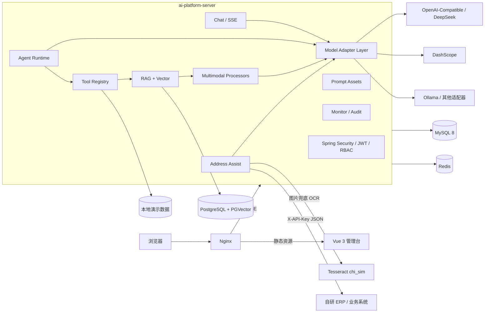

# AI 智能应用平台 — 架构设计

> 项目定位：独立的企业级 AI 智能应用平台。与 ERP 等业务系统通过 HTTP API 对接，不直连业务数据库。地址识别结果只回填调用方页面，不落库、不保存图片；演示业务数据由本项目自行维护。

## 1. 总体架构



## 2. 架构取舍

- 模块化单体，一次构建、一次部署，适合 Demo 与私有化演示。
- 模块之间通过 Java 接口与依赖倒置解耦，不使用 HTTP 相互调用。
- 业务模块不直接依赖第三方模型 SDK 的具体实现，统一经过 `model` 模块适配层。
- 与外部业务系统通过 HTTP API 对接；地址识别提供 `/api/open/v1/address/extract`（`X-API-Key`），只返回 JSON 给 ERP 页面回填，不写业务库。
- 图片识别优先走视觉模型；视觉模型不能直接输出 JSON 时，用本地 Tesseract OCR 识别文字，再交给文本模型抽取。OCR 只处理临时文件，不保存图片。
- 地址字段区分 `DOMESTIC` 与 `INTERNATIONAL`：国内使用省/市/区/街道，国外使用国家/州省/城市/地址1/地址2/邮编；页面按类型自动切换表单。
- 平台不把订单写入逻辑放在 AI 服务内；ERP 是订单主系统，负责校验、落单与后续流程。
- MySQL 负责管理域数据；PostgreSQL 只承载知识切片与向量；Redis 负责短期缓存与任务状态。
- 不使用 Spring Cloud、Nacos、Gateway、Kafka、RocketMQ、Kubernetes。

## 3. Maven 模块依赖

```text
ai-dependencies  统一父 POM / BOM（Spring Boot、LangChain4j、MyBatis-Plus、JWT、POI、PDFBox）
├── ai-common                   统一响应、异常、分页、安全上下文、基础实体、跨模块 SPI
├── ai-module-model             供应商、模型配置、API Key 加密、Chat/Vision/Embedding/ASR Adapter
├── ai-module-chat              会话、消息、SSE 对话、Token 用量
├── ai-module-agent             Agent 配置、版本、执行引擎、步骤、限制
├── ai-module-tool              工具注册、参数 Schema、Java 反射执行、调用日志
├── ai-module-prompt            Prompt、变量、版本、发布、回滚
├── ai-module-rag               知识库、文档、切片、PGVector、检索、RAG 问答
├── ai-module-multimodal        文件资产、Image/PDF/Excel/Audio Processor
├── ai-module-integration       地址识别、地址拆分、表单回填 API、ERP 开放接口
├── ai-module-monitor           模型/Agent/Tool/RAG/多模态记录、统计、费用估算
├── ai-module-audit             操作审计、脱敏
└── ai-platform-server          启动入口、Security、JWT、用户、Flyway、API 装配
```

依赖方向保持单向：

```text
server -> chat/agent/rag/multimodal/integration/monitor/audit -> model/common
tool  <-> agent（agent 使用 tool registry）
rag   -> multimodal + model
integration -> multimodal（文件能力复用）+ model（模型调用）
tool  -> rag SPI（文档检索）
```

## 4. 模型适配层

```java
ChatModelAdapter
VisionModelAdapter
EmbeddingModelAdapter
AsrModelAdapter
```

- 基于 LangChain4j 的 `ChatModel` / `StreamingChatModel` / `EmbeddingModel` 实现。
- 供应商差异（Base URL、鉴权头、兼容性参数）被封装在 Adapter 内。
- API Key 使用 AES-GCM 服务端加密，接口只返回掩码与 `hasApiKey`。
- 连通性测试执行真实网络请求；未配置 Key 的模型显示“未连接”，不伪造成功。
- 模型能力通过 `capabilities` 标签表达（TEXT / VISION / EMBEDDING / ASR / TOOL_CALLING 等）。

## 5. Agent 与 Tool

### Agent

- 统一执行接口，输入包含 Agent、用户消息、会话上下文与执行限额。
- 系统提示词 + 模型绑定 + Tool 绑定 + 会话上下文。
- 最大工具调用次数、最大执行时间、可选的调用成本预算。
- 执行步骤（模型思考请求、工具请求、工具结果、最终回答）写入 `ai_agent_step`。
- 失败时记录异常与耗时，不把失败包装成成功结果。

### Tool

- 工具元数据来自数据库，实际执行由注册为 Spring Bean 的 `PlatformTool` 完成。
- 工具参数通过 JSON Schema 描述，服务端做参数类型与必填校验。
- 执行日志记录入参（脱敏）、出参摘要、耗时、成功/失败。
- 演示数据工具（订单/库存/客户）直接访问本项目的 `ai_demo_*` 表；回答与日志中明确标记“演示数据”。
- 文档检索工具调用 RAG SPI，不复制一套向量检索逻辑。

## 6. RAG

```text
上传/导入示例 -> 类型与魔数检查 -> PDFBox/POI/TXT 文本抽取
  -> 字符窗口切片（优先段落/句号，保留 overlap）
  -> 真实 Embedding（按批调用并写模型日志）
  -> PGVector 入库
  -> 余弦距离检索 -> 拼接 Context
  -> 文本模型回答 + 来源引用
```

- 每个知识库绑定一个 Embedding 模型；演示库使用不固定维度 `vector` 列并强制按 `embedding_model_id + embedding_dim` 过滤，避免不同模型向量混用。
- 文档状态：`PROCESSING / READY / FAILED`。
- 扫描版 PDF 无文本层时明确提示需要 OCR，不伪造解析结果。
- 任何处理异常都会落库失败原因；不生成假向量，不提供假检索结果。
- 来源包含文档名、切片序号、相似度分数与引文片段。

## 7. 多模态

`MultimodalService` 按文件类型与任务类型路由：

- 图片 → `VisionModelAdapter`，用 LangChain4j `ImageContent` 发送给视觉模型，支持图片理解与 OCR 提示词。
- PDF/DOCX/XLSX/TXT → `DocumentTextExtractor`（PDFBox/POI）抽取文本；可选文本模型生成摘要或字段抽取，未选模型时返回真实解析文本。
- 音频 → `AsrModelAdapter`，调用 OpenAI-compatible `/audio/transcriptions`；供应商不支持或未配置时明确失败，不假装转录成功。
- 任务结果写入 `ai_multimodal_task`，包含模型、Token、耗时、状态和错误原因；模型调用写 `ai_model_call_log`。

## 8. 安全设计

- JWT 无状态认证；首个版本为访问令牌，角色 `ADMIN` / `USER`。
- 首登强制改密由服务端过滤器阻断，修改密码后 `token_version` 递增，旧令牌立即失效。
- 用户、会话、知识库、文件等均按所有者隔离。
- 模型 API Key AES-GCM 加密，接口永不返回明文；日志中脱敏。
- 文件类型魔数检查、大小限制、随机文件名，禁止路径穿越。
- 上传文件通过受控下载接口访问，不直接暴露物理路径。
- Tool 默认只允许启用的工具；限制工具调用次数与执行时间。
- 数据访问使用参数绑定，禁用危险 SQL。

## 9. 可观测性与审计

- 每个请求携带 `X-Trace-Id`，写入模型/工具/RAG 调用日志，便于串联。
- 所有调用记录区分 `REAL` 与 `SIMULATED`。
- 费用仅根据模型配置的输入/输出单价计算；未配置单价返回“未知”。
- 监控页面同时展示真实记录与带明确标记的 SIMULATED 演示数据，并分别统计。
- 管理端非 GET 操作由 `OperationAuditFilter` 写入 `ai_operation_audit`，只记录路径、资源、状态、耗时、IP 与 TraceId，不记录请求体。

## 10. 部署拓扑

```text
Browser
  -> Nginx (Vue 静态资源 + /api 反向代理 + SSE 关闭缓冲)
     -> ai-platform-server (8080)
        -> MySQL 8
        -> PostgreSQL + PGVector（本机 18.6 / Compose 16）
        -> Redis 7
     -> 外部大模型供应商（由用户配置）
```

Docker Compose 启动 MySQL、PostgreSQL、Redis、后端与 Nginx 前端；数据卷持久化，健康检查控制启动顺序。
